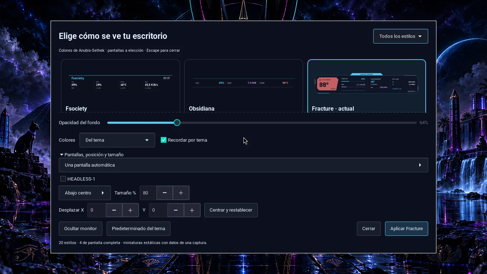

# Desktop telemetry

Twenty styles render through native Wayland and Cairo with translucent surfaces and theme-aware colors. Normal application windows cover the widgets.

Compact styles include Fsociety, Obsidian, Fracture, Signal, Orbit, Ribbon, Terminal, Pulse, Polar, Chronos, Nexus, Gotham, Prism, Scope, Stack and Focus. Atlas, Horizon, Observatory and Circuit occupy separate edge/corner regions while leaving the center open.

## Install and use

From a reviewed repository copy inside Hyprland:

```bash
sudo pacman -S --needed conky python python-gobject gtk3 ttf-jetbrains-mono
bash scripts/install-desktop-monitor.sh
black-ice-conky menu
black-ice-conky color ice
black-ice-conky opacity 0.72
black-ice-conky output all
black-ice-conky status
```

Conky requires Wayland, Cairo and `conky_surface()`; Arch Conky 1.24.2 was checked. **Super+F8** toggles visibility and **Super+Shift+F8** opens the gallery.



Choose a style, colors, opacity and placement, then **Apply**. The gallery stays open to compare changes; **Close** or Escape dismisses it. Preview data is a snapshot, not live telemetry.

**Remember per theme** stores adjustments separately; **Theme default** removes only the current customization. All 54 catalog themes have explicit defaults. Color combinations are `theme`, `swap`, `ice`, `acid`, `ember`, `orchid` and `mono`.

## Displays and position

Expand display/placement controls to select automatic output, all connected displays or individual checkboxes. A single checkbox selects one monitor. Saved names survive disconnection; selecting all follows active outputs.

Nine anchors, X/Y offsets and 65–135% scaling are clamped to usable logical display space. The supervisor shares metric collection across display instances. Its backend briefly focuses a monitor when creating its surface, checks placement and restores focus when appropriate.

Preferences live in `~/.local/state/black-ice/conky.json`. Hiding persists across theme changes. `off` keeps the lightweight supervisor; stopping its systemd service stops supervision too.

## Data and limits

Metrics use `/proc` and labeled hwmon sensors. Missing sensors show N/D; there are no Internet metric requests or dedicated GPU polling. Refresh is two seconds on external power and five on battery.

Physical three-display placement and isolated selection were checked, but sustained performance, hotplug and energy behavior still need their own evidence. Brief samples do not establish a universal CPU/memory budget.

[Spanish reference](DESKTOP_MONITOR.md) · [Validation](AUDIT_REPORT.md) · [Credits](../CREDITS.md).
