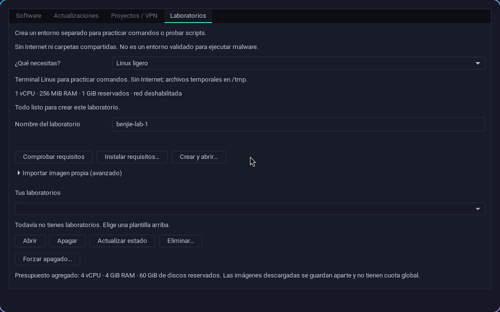

# Laboratorios guiados

Un laboratorio es un entorno separado donde practicar comandos o probar scripts. Control → Sistema → Laboratorios ofrece plantillas preparadas; no necesitas conocer KVM/Podman, buscar imágenes ni copiar hashes.



1. Elige **Linux ligero**, **Linux completo**, **Máquina virtual Linux**, **Juice Shop** o **WebGoat**.
2. Revisa la descripción y los recursos. El nombre viene preparado y puedes cambiarlo.
3. Si faltan paquetes, pulsa **Instalar requisitos**. Usa la autorización normal del sistema y muestra qué instalará.
4. Pulsa **Crear y abrir** y confirma la descarga. El asistente verifica la imagen, crea el entorno y abre su terminal, consola o navegador. Las prácticas web deben responder antes de abrirse.
5. Para volver, selecciona el laboratorio y pulsa **Abrir**. **Actualizar estado** consulta al motor. Apaga antes de eliminar; el apagado forzado tiene confirmación separada.

| Plantilla | Uso | Recursos predeterminados |
| --- | --- | --- |
| Linux ligero | Alpine 3.24.2, terminal y comandos básicos | 1 vCPU, 256 MiB RAM, 1 GiB reservado |
| Linux completo | Debian 13, terminal Bash y scripts | 1 vCPU, 512 MiB RAM, 1 GiB reservado |
| Máquina virtual Linux | Alpine 3.24.2 live, consola gráfica y disco vacío | 1 vCPU, 512 MiB RAM, disco de 4 GiB |
| Juice Shop | OWASP v19.2.1, práctica web local | 1 vCPU, 768 MiB RAM, 2 GiB reservados |
| WebGoat / WebWolf | OWASP v2026.5, lecciones web locales | 1 vCPU, 1536 MiB RAM, 3 GiB reservados |

Las terminales Linux no incluyen suites de pentesting. Juice Shop y WebGoat son aplicaciones deliberadamente vulnerables para práctica local. Los contenedores tienen raíz de solo lectura; las terminales escriben en `/tmp` y las aplicaciones web en su volumen propio. La sesión live de la VM y los archivos temporales se pierden al apagar. En la consola de la VM live escribe `root` y presiona Enter; la ISO oficial no tiene contraseña inicial. Ese usuario pertenece únicamente a la VM. No se instala automáticamente un sistema persistente ni se crea una contraseña.

## Aislamiento y descargas

Las terminales tienen la red deshabilitada; las prácticas web utilizan una red interna sin ruta predeterminada ni DNS y puertos publicados solo en `127.0.0.1`. No se comparten carpetas del equipo. Los contenedores usan Podman rootless, usuario numérico sin root, límites de CPU/RAM/PIDs, ninguna capacidad y bloqueo de nuevos privilegios. Abrir o iniciar vuelve a comprobar el aislamiento. La VM utiliza KVM de sesión y no incorpora interfaces de red ni dispositivos/carpetas del host.

La primera preparación descarga por la conexión normal del equipo; una imagen ya preparada se reutiliza sin consultar al registro. Las imágenes oficiales de contenedor se fijan por digest antes de crear el recurso. La ISO se verifica contra el SHA256 incluido en la plantilla y se publica en la caché solo después de comprobarlo; un archivo corrupto no se reutiliza. Estas verificaciones no equivalen a una garantía de ausencia de vulnerabilidades. El catálogo fija versiones; actualizar una imagen preparada debe ser una decisión explícita.

El presupuesto agregado de laboratorios es 4 vCPU, 4 GiB RAM y 60 GiB de discos reservados. Tor del sistema tiene un servicio separado, limitado a una CPU y 512 MiB; no se descuenta de ese presupuesto de laboratorios. El almacén nuevo tiene control de preparación, limpieza revisable y vencimiento, descritos en [Seguridad](SECURITY_WORKSPACE.md). No es una cuota física del sistema de archivos. Los contenedores comparten kernel con el host: estas plantillas no son una sandbox validada para malware.

Las aplicaciones web conservan sus datos hasta eliminar el laboratorio. Algunas lecciones que requieren servicios externos no funcionan dentro de una red sin Internet. WebWolf publica su segundo puerto únicamente en localhost; el asistente abre WebGoat como entrada principal. La captura superior corresponde al asistente anterior de tres plantillas; la apariencia final ampliada está pendiente de revisión.

## Imágenes propias y CLI

**Importar imagen propia (avanzado)** conserva qcow2 y contenedores por digest. El hash del qcow2 local se calcula automáticamente: confirma integridad del archivo elegido, no su procedencia. Solo se gestionan recursos y discos del registro propio.

```bash
black-ice-system labs presets
black-ice-system labs requirements --preset alpine
black-ice-system labs create benjie-lab --preset alpine
black-ice-system labs open benjie-lab
black-ice-system labs status benjie-lab
black-ice-system labs stop benjie-lab
black-ice-system labs delete benjie-lab --confirm benjie-lab
```

Puedes exportar una plantilla guiada con `labs export benjie-lab --output ARCHIVO`. El archivo contiene la selección y recursos; excluye rutas privadas de caché/disco. `labs create --template ARCHIVO` vuelve a prepararla desde la fuente oficial.

Fuentes: [versiones Alpine](https://alpinelinux.org/releases/), [imágenes oficiales Docker](https://docs.docker.com/docker-hub/image-library/official-images/), [Podman](https://docs.podman.io/en/latest/markdown/podman-run.1.html).
