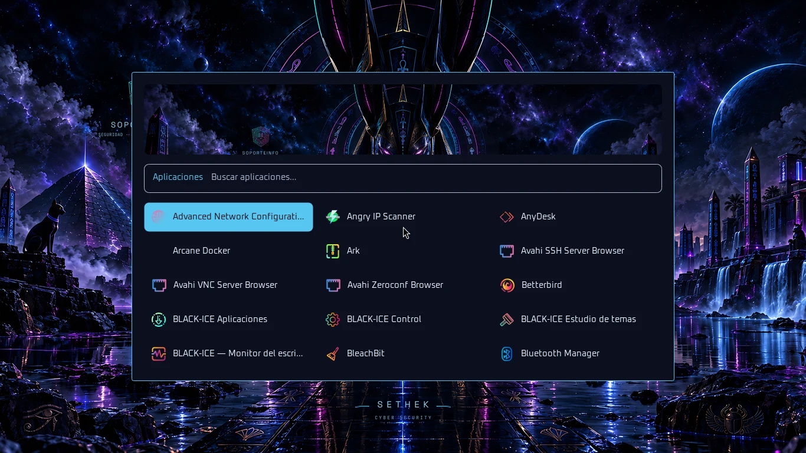

# Lanzador de aplicaciones

**Super+D** y pulsar/soltar **Super** abren el lanzador. Repetir el atajo cierra su propia instancia. **Super+Alt+T → Apariencia → Lanzador** permite elegir y probar el estilo.

| Estilo | Diseño |
|---|---|
| Panorámico | Cabecera con el fondo activo y tres columnas de aplicaciones |
| Compacto | Lista vertical para pantallas pequeñas |
| Mosaicos | Cuadrícula de iconos |
| Clásico | Wofi, compatible con la configuración anterior |

Rofi recibe colores, fuente y fondo del tema seleccionado. La ventana se ajusta al monitor enfocado. Wofi sirve de alternativa si Rofi no está disponible. Instala `rofi` en Arch para usar los tres diseños nuevos; ambos paquetes forman parte del despliegue.

La preferencia está en `~/.config/black-ice/launcher.json`. El lanzador no necesita un proceso residente. Sus bloqueos se separan por instancia de Hyprland, de modo que una sesión de pruebas no cierre el menú del escritorio principal.

Para revisar una personalización Rasi, utiliza `rofi -no-config -theme ARCHIVO -dump-theme` y comprueba también stderr: una salida 0 no garantiza que se haya aceptado el archivo.
